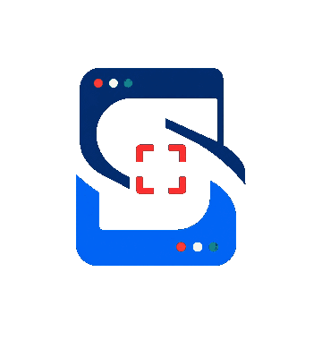
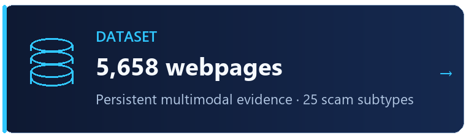
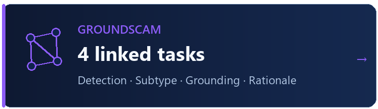
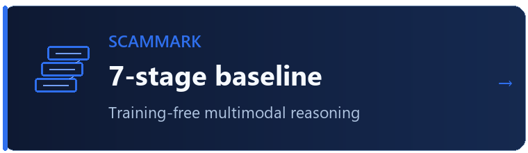
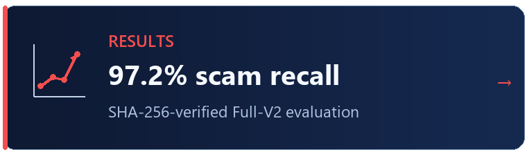
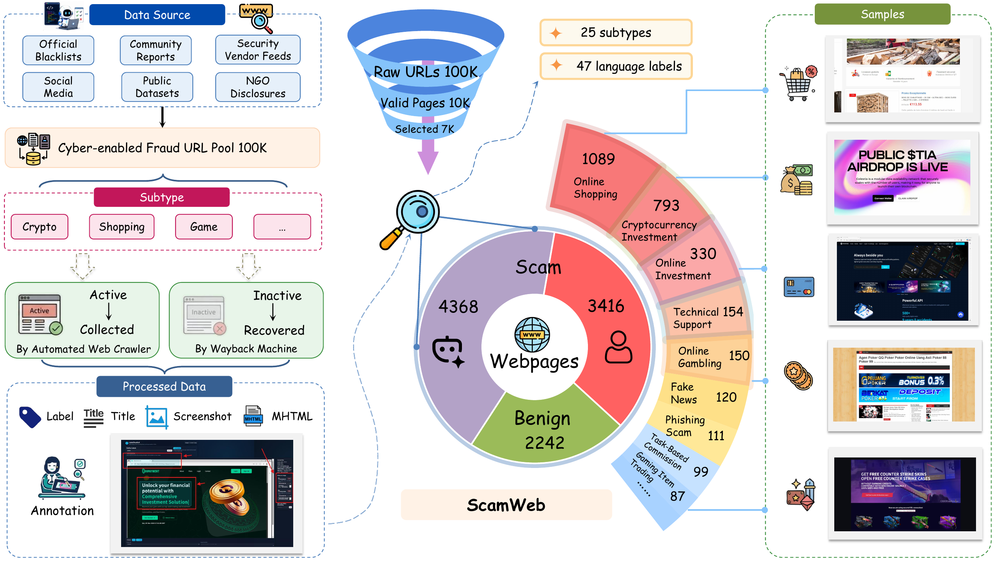
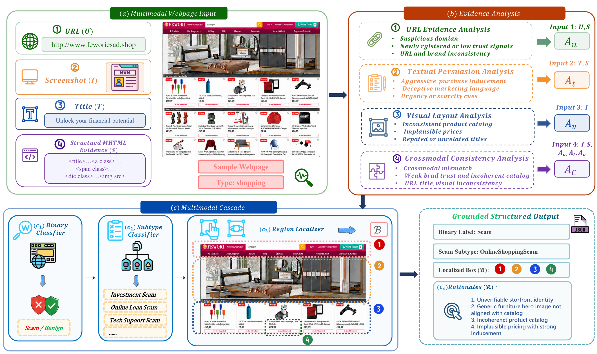
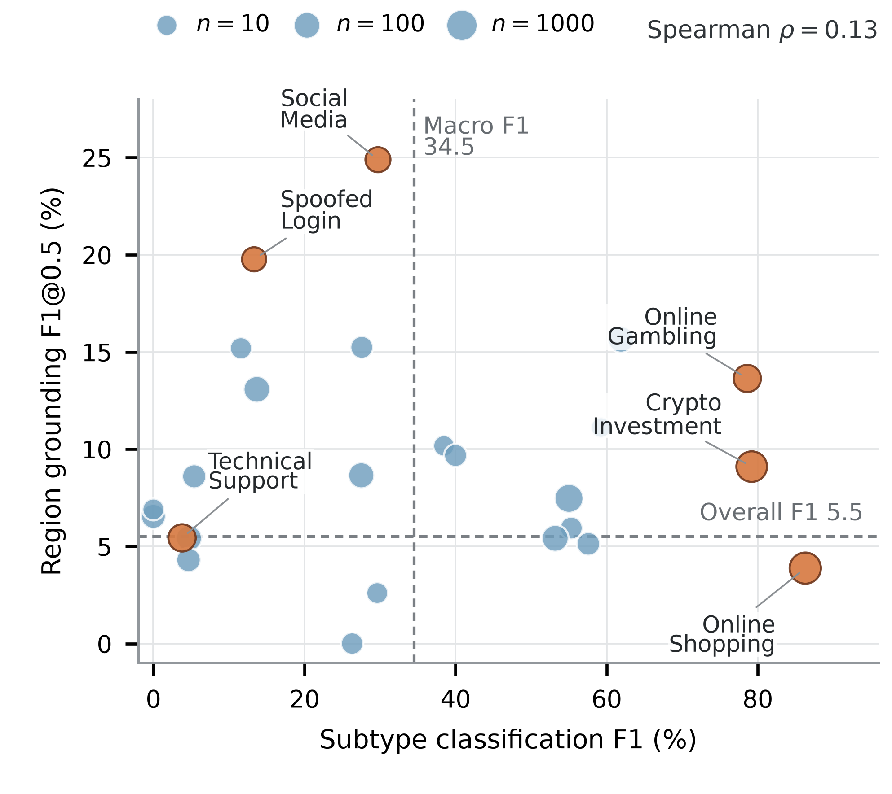

<div align="center">
  <picture>
    <source media="(prefers-reduced-motion: reduce)" srcset="docs/assets/scamweb_logo.png">
    
  </picture>
  <h1>ScamWeb</h1>
  <p><strong>A Multimodal Benchmark for Grounded Understanding of Cyber-enabled Fraud Webpages</strong></p>
  <p>
    Persistent webpage evidence &nbsp;&bull;&nbsp;
    Fine-grained scam taxonomy &nbsp;&bull;&nbsp;
    Region grounding &nbsp;&bull;&nbsp;
    Human-written rationales
  </p>

  <p>
    <a href="https://www.python.org/"></a>
    <a href="https://huggingface.co/datasets/kirco567/ScamWeb-Dataset"></a>
    <a href="LICENSE"></a>
    <a href="#dataset"></a>
    <a href="https://aaai.org/conference/aaai/aaai-27/"></a>
  </p>

  <p>
    <a href="https://github.com/Kirito14IT/ScamWeb"><strong>GitHub</strong></a>
    &nbsp;&middot;&nbsp;
    <a href="https://huggingface.co/datasets/kirco567/ScamWeb-Dataset"><strong>Hugging Face Dataset</strong></a>
    &nbsp;&middot;&nbsp;
    <a href="#scammark"><strong>ScamMark</strong></a>
    &nbsp;&middot;&nbsp;
    <a href="#results"><strong>Results</strong></a>
    &nbsp;&middot;&nbsp;
    <a href="#quick-start"><strong>Quick Start</strong></a>
    &nbsp;&middot;&nbsp;
    <a href="SECURITY.md"><strong>Safety</strong></a>
  </p>
</div>

---

## Explore ScamWeb

<table>
  <tr>
    <td width="50%">
      <a href="#dataset"></a>
    </td>
    <td width="50%">
      <a href="#four-linked-tasks"></a>
    </td>
  </tr>
  <tr>
    <td width="50%">
      <a href="#scammark"></a>
    </td>
    <td width="50%">
      <a href="#results"></a>
    </td>
  </tr>
</table>

<details>
<summary><strong>What is included in the code and dataset releases?</strong></summary>

- **Code and contracts:** the executable [`src/scammark/`](src/scammark/) baseline,
  benchmark statistics, taxonomy support, prompts, configurations, tests, and
  the formal experiment contract.
- **Public dataset:** the [Hugging Face release](https://huggingface.co/datasets/kirco567/ScamWeb-Dataset) provides the
  5,658-page benchmark as self-contained Parquet records, including screenshots,
  archived MHTML, and annotations. See its dataset card for schemas and downloads.
- **Frozen evaluation metadata:** the [Full-V2 contract](docs/EXPERIMENT_RELEASE_V2.md)
  describes the separately audited metadata used for the reported evaluation.
  Historical access-controlled GitHub Release assets and experiment outputs are
  not bundled into this code repository.
- **Code downloads:** GitHub's `Source code` archives contain this source tree,
  not the Hugging Face dataset or model weights.
- **Reproduction boundary:** the repository materials support installation,
  offline fake-client tests, prompt and contract inspection, and frozen-metadata
  verification. Full multimodal ScamMark inference and from-scratch metric
  reproduction additionally require an authorized copy of the external raw
  archive and configured model-provider access.

</details>

<details>
<summary><strong>How do I reproduce the formal evaluation safely?</strong></summary>

Start with the [Quick Start](#quick-start), validate the frozen
[Full-V2 contract](docs/EXPERIMENT_RELEASE_V2.md), and follow
[SECURITY.md](SECURITY.md) before handling archived webpages. The public dataset is distributed on
[Hugging Face](https://huggingface.co/datasets/kirco567/ScamWeb-Dataset); the native evaluation harness expects the
raw directory layout documented in the dataset contract.

</details>

## Overview

**ScamWeb** is a multimodal and multilingual benchmark for understanding
cyber-enabled fraud webpages. It aligns four persistent views under a
conservative evidence policy:

1. **URL and title metadata** for identity and domain-level signals.
2. **A full-page screenshot** for layout, visual persuasion, and region grounding.
3. **Audited MHTML/DOM evidence**, when trusted, for text, structure, forms, and calls to action.
4. **Expert annotations** for the page label, scam subtype, evidence regions, and rationales.

Unlike a detector that returns only a binary label, ScamWeb evaluates whether a
system can recognize fraud, identify its form, point to the deceptive evidence,
and explain why that evidence matters.

<table>
  <tr>
    <td align="center"><strong>5,658</strong><br><sub>frozen webpages</sub></td>
    <td align="center"><strong>3,416</strong><br><sub>scam pages</sub></td>
    <td align="center"><strong>2,242</strong><br><sub>benign pages</sub></td>
    <td align="center"><strong>25</strong><br><sub>scam subtypes</sub></td>
    <td align="center"><strong>5,489</strong><br><sub>expert regions</sub></td>
  </tr>
</table>

<p align="center">
  
</p>
<p align="center">
  <em>The latest formal-submission overview, reproduced verbatim. The purple 4,368 segment is auxiliary machine-annotated scam data and is excluded from the frozen evaluation contract. That contract contains the red 3,416 expert-annotated scam pages plus the green 2,242 benign pages: 5,658 pages in total. Funnel labels are rounded collection-stage counts.</em>
</p>

### Four linked tasks

| Task | Required output | Primary metrics |
| --- | --- | --- |
| **Fraud detection** | `scam` or `benign` | Accuracy, precision, recall, F1 |
| **Subtype classification** | One of 25 single-label scam types | Accuracy, macro precision, macro recall, macro F1 |
| **Evidence grounding** | One or more screenshot-space regions | mIoU, P/R/F1@0.5, page Recall@0.3/0.5 |
| **Rationale generation** | A reason paired with each grounded region | ROUGE-L, multilingual BERTScore, grounded coverage |

Together, these four tasks form **GroundScam**, the paper's unified evaluation
setting.

## Dataset

The frozen benchmark contract defines **5,658 evaluation records**. The scam set
adds a single canonical subtype and one to four expert regions with
human-written reasons; benign pages carry the same persistent input modalities
without scam evidence annotations. These records define the evaluation corpus,
not the larger collection-stage funnel of candidate URLs and captures.

The table below describes the coverage expected in an authorized raw archive;
it is not an inventory of files distributed in this repository or its Releases.

| Raw-archive artifact role | Required coverage | Format and policy |
| --- | ---: | --- |
| Page metadata | 5,658 pages | Workbook-derived structured records |
| Full-page screenshots | 5,658 pages | PNG |
| Trusted MHTML/DOM evidence | 5,482 pages | MHTML-derived fields; 161 mismatches and 15 missing/corrupt archives are withheld from model input |
| Gold subtype and evidence annotations | 3,416 scam pages | JSON |

Machine-readable aggregate statistics, taxonomy support, integrity hashes, and
the fixed 70/15/15 supervised split are versioned in [`metadata/`](metadata/).
The source hierarchy and audit policy are documented in
[`docs/DATASET.md`](docs/DATASET.md).

### Dataset access

The dataset is available on **[Hugging Face](https://huggingface.co/datasets/kirco567/ScamWeb-Dataset)**. The `samples`
configuration contains the **5,658-page benchmark**; `artifacts` contains
supporting annotation and collection files. Both use the `full` split. The
release contains 79 compressed Parquet shards (about 29.73 GB), with original
media stored as bytes.

Browse records without downloading the complete release:

```bash
pip install datasets
```

```python
from datasets import load_dataset

pages = load_dataset(
    "kirco567/ScamWeb-Dataset", "samples", split="full", streaming=True
)
page = next(iter(pages))
print(page["sample_id"], page["category"])
```

The dataset card documents full downloads, schemas, licensing, and checksums.
Pin the dataset revision when reporting results. Git contains no raw webpage
archive. The native builder below expects the [original directory layout](docs/DATASET.md#expected-raw-layout),
not the Parquet download directory: place restored raw files outside the code
repository and expose their root through `SCAMWEB_DATASET_ROOT`.

This README uses English semantic names for every data role. Acquisition-time
filenames are treated as private archive details and are normalized into
English structured fields by the dataset builder.

```bash
export SCAMWEB_DATASET_ROOT=/data/scamweb_dataset
python -m data.scamweb_dataset \
  --output-dir outputs/dataset \
  --reports-dir reports
```

> [!CAUTION]
> Never open collected MHTML as trusted local content. Process raw webpages in
> an isolated research environment and read [SECURITY.md](SECURITY.md) before
> handling the archive.

## ScamMark

**ScamMark** is the paper's training-free LLM-VLM baseline. It combines URL,
textual, visual, and structural evidence through staged reasoning, then returns
a grounded structured prediction.

<p align="center">
  
</p>
<p align="center">
  <em>The latest ScamMark workflow, rendered directly from the formal-submission PDF.</em>
</p>

| Stage | Module | Purpose |
| ---: | --- | --- |
| 1 | URL analysis | Inspect domain, token, redirect, and brand-domain signals |
| 2 | Text analysis | Identify claims, persuasion, forms, actions, and contact channels |
| 3 | Visual analysis | Read page genre, layout, trust cues, and candidate regions |
| 4 | Cross-modal analysis | Reconcile agreement and contradiction across modalities |
| 5 | Binary classifier | Predict `scam` or `benign` |
| 6 | Subtype classifier | Select one canonical scam subtype |
| 7 | Grounding and rationale | Localize evidence regions and explain each one |

The formal run routes the URL and text stages to **GPT-4o-mini**, and the visual
and downstream stages to **Qwen3-VL-Flash**, with temperature set to zero. A
benign binary decision stops the normal cascade; forced downstream execution is
used only for diagnostic evaluation.

Gold labels, boxes, reasons, file paths, and audit-only fields are removed
recursively before prompt construction. The full frozen contract is described
in [`docs/EXPERIMENT_RELEASE_V2.md`](docs/EXPERIMENT_RELEASE_V2.md).

## Results

The table below reports the SHA-256-verified Full-V2 run used by the formal
submission. Except for mIoU, values are percentages.

This public code repository does not include the historical prediction or
final-evaluation packages. The summary below is preserved from the formal
submission; it is not a new run and cannot be recomputed from source code alone.

| Task | Evaluation scope | Result |
| --- | --- | --- |
| **Binary detection** | 5,658 pages | Acc **68.3**, P **66.1**, R **97.2**, F1 **78.7** |
| **25-way subtype classification** | 3,416 scam pages | Acc **63.7**, macro P/R/F1 **52.2 / 37.4 / 34.5** |
| **Region grounding** | 3,416 scam pages | mIoU **0.173**, P/R/F1@0.5 **3.5 / 12.4 / 5.5**, Recall@0.3/0.5 **23.5 / 14.5** |
| **Grounded rationales** | Matched regions + end-to-end coverage | ROUGE-L **13.4**, BERTScore **87.6**, coverage **12.4** |

The binary stage is deliberately sensitivity-oriented, reaching 97.2% recall.
The much lower macro subtype and grounding scores expose the benchmark's core
challenge: recognizing that a page is suspicious is easier than assigning a
fine-grained type and localizing the exact deceptive evidence.

<p align="center">
  
</p>
<p align="center">
  <em>Subtype recognition and spatial grounding are only weakly correlated across the 25 scam types.</em>
</p>

## Quick Start

Python **3.12** is the reference interpreter.

```bash
git clone https://github.com/Kirito14IT/ScamWeb.git
cd ScamWeb
python3.12 -m venv .venv
source .venv/bin/activate
python -m pip install --upgrade pip
python -m pip install -e .
```

<details>
<summary><strong>Windows PowerShell setup</strong></summary>

```powershell
git clone https://github.com/Kirito14IT/ScamWeb.git
Set-Location ScamWeb
py -3.12 -m venv .venv
.\.venv\Scripts\Activate.ps1
python -m pip install --upgrade pip
python -m pip install -e .
```

</details>

### Zero-API validation

The unit suite uses fake clients and does not call paid providers:

```bash
python -m unittest \
  tests.test_scammark \
  tests.test_scamweb_dataset \
  tests.test_scammark_evaluation \
  tests.test_paper_baselines
```

The formal Full-V2 preflight is **Linux-only** because it uses POSIX
no-follow directory handles. It requires both the verified
`outputs/dataset_frozen_v1` metadata bundle described in the
[experiment release contract](docs/EXPERIMENT_RELEASE_V2.md) and the authorized
raw screenshot tree at `SCAMWEB_DATASET_ROOT`. Set that variable and the formal
`SCAMMARK_VLM_BASE_URL` directly or through `.env`, then validate the contract
without issuing API requests. API keys are not used by this check.

```bash
python -m scammark.run_experiment \
  --config configs/qwen3_dashscope_server_full_v2.toml \
  --full \
  --validate-only
```

The validator intentionally refuses to continue if the frozen inputs are absent
or any recorded hash has drifted.

Windows supports the unit suite above; run the formal preflight in the Linux
server environment described by the release contract.

<details>
<summary><strong>API configuration, pilots, evaluation, and baselines</strong></summary>

Create a local `.env` from [`.env.example`](.env.example). Never commit
credentials.

```bash
cp .env.example .env
chmod 600 .env
```

Required runtime variables are `SCAMMARK_LLM_API_KEY`,
`SCAMMARK_VLM_API_KEY`, `SCAMMARK_VLM_BASE_URL`, and
`SCAMWEB_DATASET_ROOT`.

Run the 10- and 60-page engineering pilots before a full experiment:

```bash
python -m scammark.run_experiment \
  --config configs/qwen3_dashscope.toml --pilot 10 --resume

python -m scammark.run_experiment \
  --config configs/qwen3_dashscope.toml --pilot 60 --resume
```

Evaluate a completed run:

```bash
python -m scammark.evaluate \
  --predictions outputs/run/full/predictions.jsonl \
  --manifest outputs/dataset_frozen_v1/scamweb_v_manifest.jsonl \
  --output outputs/run/full/metrics.json
```

Run the supervised URL-XGBoost baseline:

```bash
python -m pip install -e ".[baselines]"
python -m scammark.run_baselines \
  --baseline url-xgboost \
  --manifest outputs/dataset_frozen_v1/scamweb_v_manifest.jsonl \
  --split metadata/fixed_split_v1.json \
  --dataset-root "$SCAMWEB_DATASET_ROOT" \
  --output-dir outputs/baselines/url-xgboost
```

Replace `url-xgboost` with `clip-lr` for the screenshot baseline. CLIP-LR also
requires a compatible PyTorch installation and the configured CLIP weights.

</details>

For a long-running deployment on a Linux server, adapt the optional operations
runbook in [`docs/SERVER_FULL_RUN_V2.md`](docs/SERVER_FULL_RUN_V2.md). It covers
process supervision, pause/resume, acceptance gates, and result retrieval. The
runbook records the authors' ARM64 DGX reference environment; DGX hardware is
not a ScamMark requirement, and its architecture-specific setup steps should be
replaced as needed for another compatible compute environment.

## Repository Map

| Path | Responsibility |
| --- | --- |
| [`configs/`](configs/) | Versioned pilot and full-run configurations |
| [`metadata/`](metadata/) | Dataset statistics, taxonomy support, hashes, and fixed split |
| [`src/data/`](src/data/) | Dataset indexing and evidence extraction |
| [`src/scammark/`](src/scammark/) | Pipeline, prompts, reliability, evaluation, and baselines |
| [`scripts/server/`](scripts/server/) | Server preparation, monitoring, and delivery |
| [`scripts/windows/`](scripts/windows/) | Frozen-input packaging and result retrieval |
| [`docs/`](docs/) | Dataset, experiment, safety, and server runbooks |
| [`tests/`](tests/) | Offline unit and contract tests |

Generated data, caches, checkpoints, logs, and results are ignored by Git. The
repository contains neither API credentials nor the raw dataset.

## Reproducibility and Safety

- The seed is fixed to `2027`; temperature is `0`, and model thinking is disabled.
- Formal prompts are English, schema-constrained, and hashed with their inputs and configuration.
- Every API stage is checkpointed with bounded retries and sanitized event logs.
- The frozen benchmark policy keeps every page while withholding malformed or mismatched MHTML from model input.
- Provider routing, attempts, token usage, latency, finish reasons, and safe error classes are recorded.
- Scam pages may contain deceptive, explicit, or otherwise harmful content.

Please read [SECURITY.md](SECURITY.md) before handling raw pages or reporting a
vulnerability.

## Citation

The archival citation will be added after the anonymous review period. During
review, cite the accompanying anonymous AAAI 2027 submission:

> **ScamWeb: A Multimodal Benchmark for Grounded Understanding of Cyber-enabled Fraud Webpages.**<br>
> Anonymous submission, AAAI 2027.

## License

Source code is released under the [Apache License 2.0](LICENSE). This license
does not grant rights to the raw dataset, third-party webpages, model weights,
provider services, or trademarks. Dataset access and redistribution are
governed separately.

Contributions are welcome; see [CONTRIBUTING.md](CONTRIBUTING.md) for the
development workflow.
